# BÁO CÁO THỰC HÀNH C# WINFORMS

## THÔNG TIN SINH VIÊN
- **Họ và tên:** Nguyễn Trường Giang
- **Mã số sinh viên:** 24810310200
- **Lớp:** D19CNPM3
- **Tên môn học:** Lập trình .NET
- **Nội dung:** bài tập thực hành 12-11

---

## KẾT QUẢ THỰC HÀNH

### BÀI 5.1: FORM ĐĂNG KÝ TÀI KHOẢN VÀ BẮT LỖI GIAO DIỆN  (ERRORPROVIDER) 
**1. Khi nhấn nút ĐĂNG KÝ**
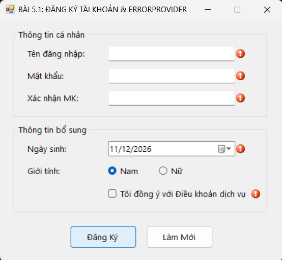
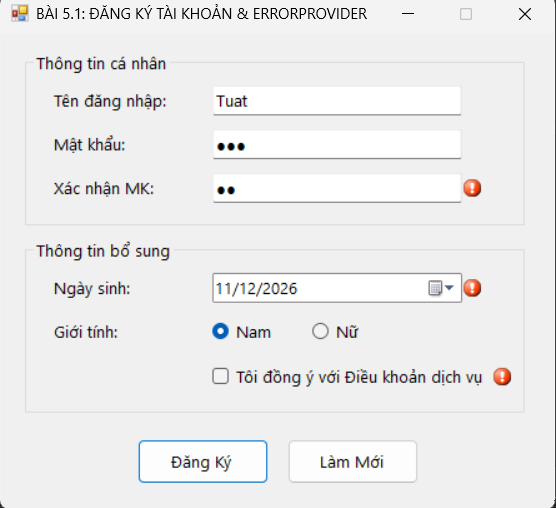
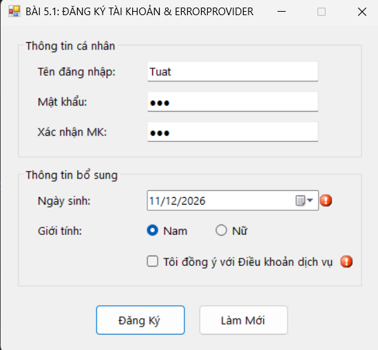
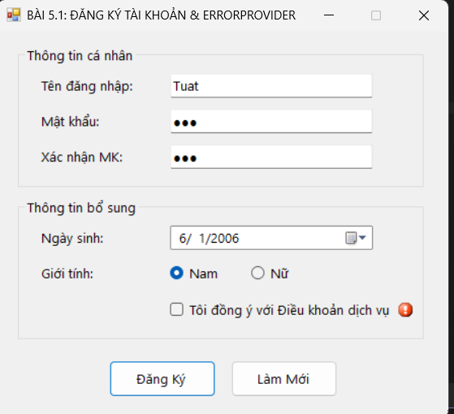

**2. Hợp lệ, hiển thị thông báo thành công**
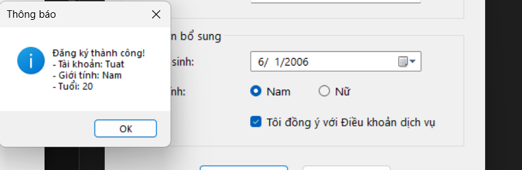

---

### BÀI 5.2: BẢNG TÍNH TIỀN DỊCH VỤ VÀ CHIẾT KHẤU ĐƠN HÀNG  (LISTBOX & COMBOBOX) 

**1. Yêu cầu chức năng**
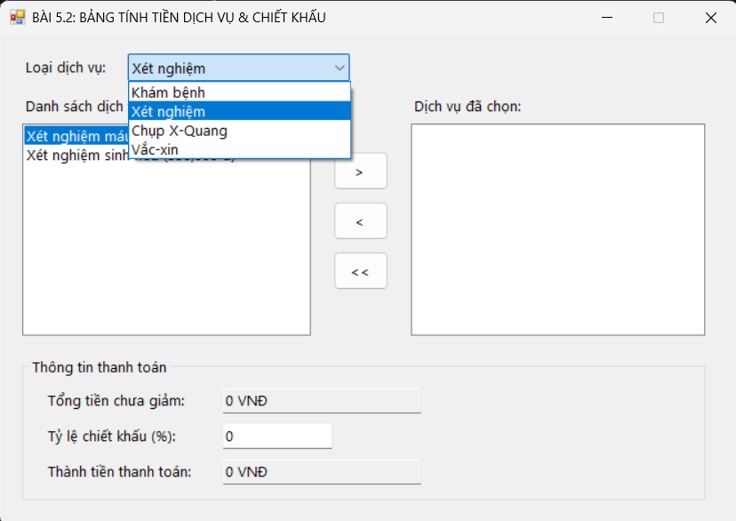

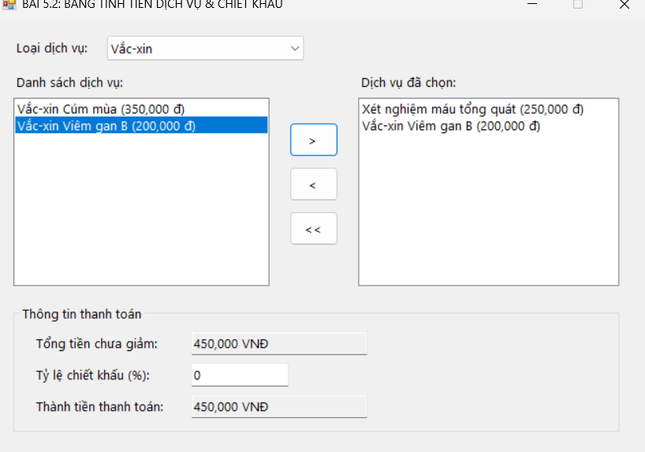

---

### BÀI 5.3: FORM QUẢN LÝ DANH SÁCH SẢN PHẨM TRONG BỘ NHỚ (DATAGRIDVIEW CƠ BẢN) 
**1.Yêu cầu chức năng**

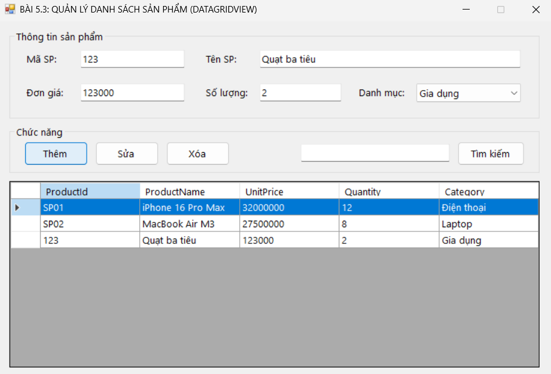
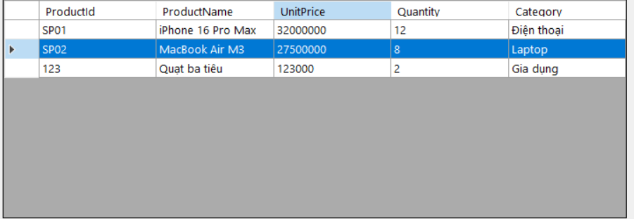
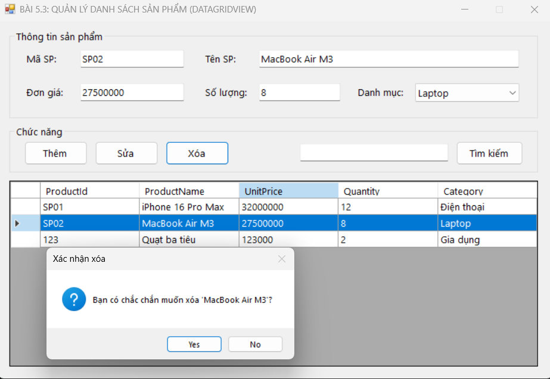
---

### BÀI 5.4: TRÌNH QUẢN LÝ TẬP TIN DẠNG CHUYÊN NGHIỆP  (TREEVIEW & LISTVIEW) 

**1. Yêu cầu chức năng**
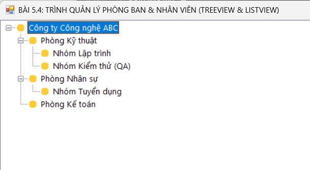
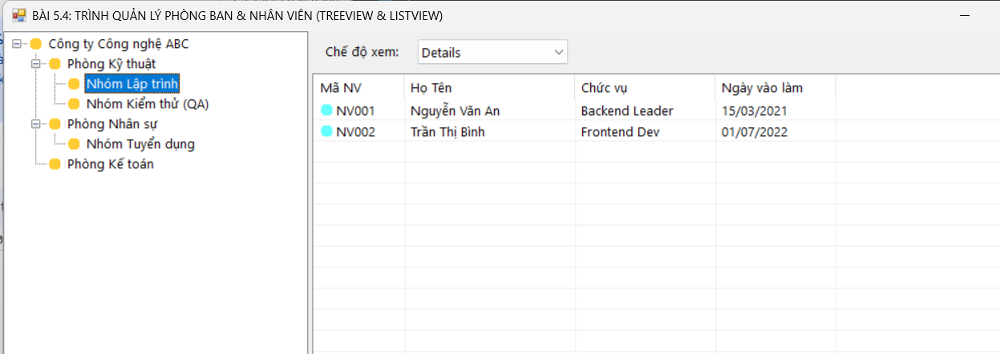
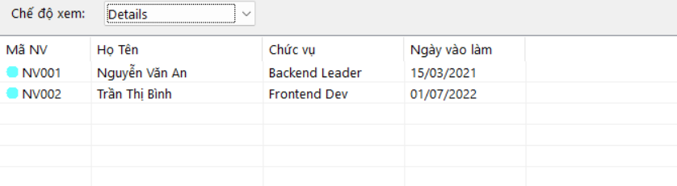